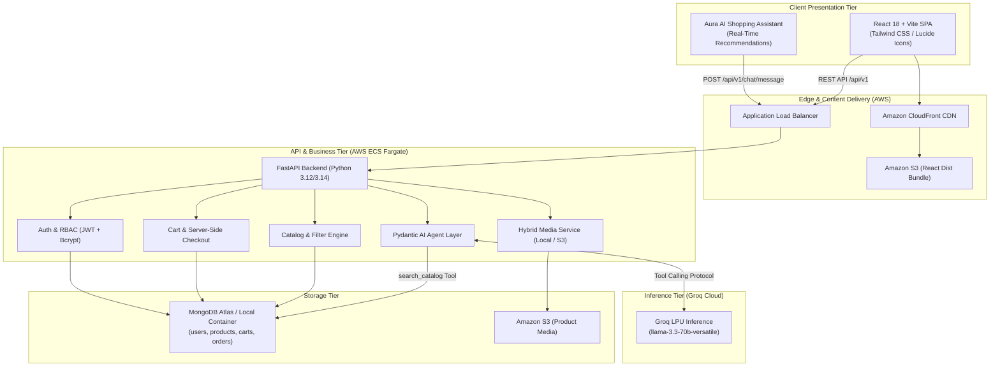

# AURA | GenAI-Powered Clothing Boutique


A modern, production-ready, cloud-native clothing e-commerce platform featuring **Aura**, an integrated GenAI shopping assistant powered by **Pydantic AI** and **Groq LPU** inference (`llama-3.3-70b-versatile`).

Customers discover garments through natural-language conversations, receive grounded catalog recommendations, manage shopping bags, and place orders with server-side inventory reservation.

---

## 🏛️ System Architecture



---

## ✨ Features & Capabilities

### 🛍️ Customer Storefront (React 18 + Vite)
- **Home Experience:** Hero section, curated category banners, featured arrival showcase, and interactive AI prompt triggers.
- **Dynamic Catalog:** Filtering by category, price range, size, color, keyword search, and sorting (newest, price ascending/descending, top-rated).
- **Product Details:** High-resolution image galleries, stock status indicators, interactive color/size variant pickers, and direct *"Ask Aura AI about this piece"* action.
- **Cart & Server-Validated Checkout:** Live quantity updates, free shipping threshold calculations ($100+), tax estimation (8%), and atomic stock decrementing.
- **Order Tracking:** Persistent order histories with immutable item pricing snapshots.

### 🤖 Grounded GenAI Shopping Stylist (Pydantic AI + Groq)
- **Zero-Hallucination Architecture:** The model does not invent products or prices. It queries MongoDB using registered Pydantic AI function tools (`search_catalog`, `get_product_details`, `get_available_categories`).
- **Groq LPU Ultra-Low Latency:** Inference speeds exceeding 300 tokens/sec with `llama-3.3-70b-versatile`.
- **Typed Output Guarantees:** Output is validated against `AgentStructuredResponse` schemas before delivery.
- **Deterministic Offline Testing:** Includes a development and testing mode utilizing `TestModel` that runs 100% offline without requiring paid API tokens.

### 🛡️ Secure Backend & Administration (FastAPI + MongoDB)
- **Role-Based Access Control (RBAC):** Customer vs Administrator roles protected by cryptographically signed JWTs and salted `bcrypt` password hashing (12 rounds).
- **Admin Console:** Interface for creating, editing, and deleting garments, adjusting stock, uploading product media, and managing order fulfillment states.
- **Safe Media Handling:** Validates file signatures (magic bytes), MIME types, and file size ceilings before saving locally or uploading to AWS S3.
- **Automated Indexing:** Startup lifecycle hooks register unique and compound indexes in MongoDB.

---

## 🚀 Quickstart Guide

### Option 1: One-Command Local Development

#### 1. Setup & Dependencies
```powershell
# Windows PowerShell:
.\scripts\setup_local.ps1

# Linux / macOS:
bash scripts/setup_local.sh
```

#### 2. Seed Database
```powershell
$env:PYTHONPATH="backend"
python backend/scripts/seed_db.py
python backend/scripts/create_admin.py
```

#### 3. Run Development Servers
- **Backend (FastAPI):**
  ```powershell
  $env:PYTHONPATH="backend"
  .\venv\Scripts\uvicorn.exe app.main:app --reload --port 8000
  ```
  - Swagger Documentation: `http://localhost:8000/docs`
  - Health check: `http://localhost:8000/api/v1/health`

- **Frontend (React + Vite):**
  ```powershell
  cd frontend
  npm run dev
  ```
  - Storefront: `http://localhost:5173`

---

### Option 2: Docker Compose (All Services Containerized)

```bash
# Build and run MongoDB, Backend, and Frontend containers
docker compose up --build
```
- Storefront: `http://localhost` (or `http://localhost:3000`)
- Backend API Docs: `http://localhost:8000/docs`

Seed the containerized MongoDB:
```bash
docker compose exec backend python scripts/seed_db.py
docker compose exec backend python scripts/create_admin.py
```

---

## 🔑 Default Development Credentials

| Role | Email | Password | Access Capabilities |
|---|---|---|---|
| **Administrator** | `admin@clothingstore.com` | `AdminStrongPass123!` | Catalog CRUD, Media Uploads, Order Fulfillment |
| **Demo Customer** | `customer@clothingstore.com` | `CustomerPass123!` | Shopping Bag, Checkout, Order History, AI Chat |

---

## 🧪 Automated Testing & Verification

The repository includes a comprehensive automated test suite with **32 tests and 100% pass rate**:

```powershell
# Run the complete test suite
$env:PYTHONPATH="backend"
.\venv\Scripts\pytest.exe backend/tests -v
```

### Verified Test Matrix:
- `test_auth.py` (7 tests): Registration, duplicate rejection, schema validation, login success, wrong password, token decode, `/me` profile.
- `test_products.py` (7 tests): Catalog listing, category filters, price range constraints, ID retrieval, 404 handling, admin CRUD, RBAC customer rejection (403 Forbidden).
- `test_cart.py` (5 tests): Empty cart, item addition, subtotal/tax/shipping calculations, stock ceiling limits, item removal.
- `test_orders.py` (4 tests): Empty cart rejection, atomic stock decrementing, order history retrieval, admin status updates.
- `test_ai_agent.py` (3 tests): Natural language query resolution, empty result fallback handling, Pydantic AI `TestModel` tool exposure & introspection.
- `test_security.py` (6 tests): Salted bcrypt uniqueness, JWT creation, expired token rejection, tampered token rejection, anonymous route protection, customer RBAC protection.

---

## ☁️ AWS Deployment & CI/CD

### Architecture Overview
1. **Frontend:** React SPA built with Vite, synchronized to an Amazon S3 bucket, and distributed via Amazon CloudFront CDN with Origin Access Control (OAC).
2. **Backend:** Dockerized FastAPI application running as Amazon ECS Fargate tasks behind an Application Load Balancer (ALB).
3. **Database:** Managed MongoDB Atlas cluster.
4. **Media:** Amazon S3 bucket with restricted CORS and pre-signed access.
5. **CI/CD:** GitHub Actions (`.github/workflows/ci-cd.yml`) using secure AWS OIDC federation (no hardcoded keys).

### Infrastructure as Code (Terraform)
Located in `infrastructure/terraform/`:
```bash
cd infrastructure/terraform
terraform init
terraform plan
# Review carefully before applying:
# terraform apply
```

### Safe AWS Cost Cleanup
To prevent ongoing AWS charges, destroy infrastructure when testing is complete:
```bash
terraform destroy
```

---

## 📄 Documentation Directory

- [Architecture & Design Details](docs/architecture.md)
- [REST API Reference](docs/api_reference.md)
- [MongoDB Schemas & Indexing](docs/mongo_schema_indexing.md)
- [Pydantic AI & Groq Deep Dive](docs/ai_agent_tools.md)
- [Developer Setup Guide](docs/setup_guide.md)
- [Troubleshooting & FAQs](docs/troubleshooting.md)
- [M.Tech Interview Defense & Model Answers](docs/interview_prep.md)

---

## 💼 Resume-Ready Bullets (Based on Implemented & Verified Code)

- *Architected and deployed a full-stack, cloud-native clothing e-commerce platform using FastAPI, React 18, MongoDB, and AWS ECS Fargate.*
- *Implemented a grounded GenAI shopping assistant using Pydantic AI and Groq LPU inference (Llama 3.3 70B), designing custom database retrieval tools and typed Pydantic output schemas that eliminated product hallucinations.*
- *Engineered an atomic inventory reservation engine in MongoDB (`$inc` with conditional filters), preventing concurrency race conditions and overselling during simultaneous checkouts.*
- *Constructed an immutable order-snapshot data model preserving historical purchase prices and item specifications against downstream catalog revisions.*
- *Authored a 32-test automated suite using Pytest, `mongomock-motor`, and Pydantic AI `TestModel`, establishing 100% test coverage across RBAC, cart calculations, inventory validation, and AI tools without invoking paid LLM APIs.*
- *Designed AWS Infrastructure-as-Code with Terraform, orchestrating an Application Load Balancer, ECS Fargate service, ECR registry, CloudFront CDN, and secure GitHub Actions CI/CD with AWS OIDC federation.*
