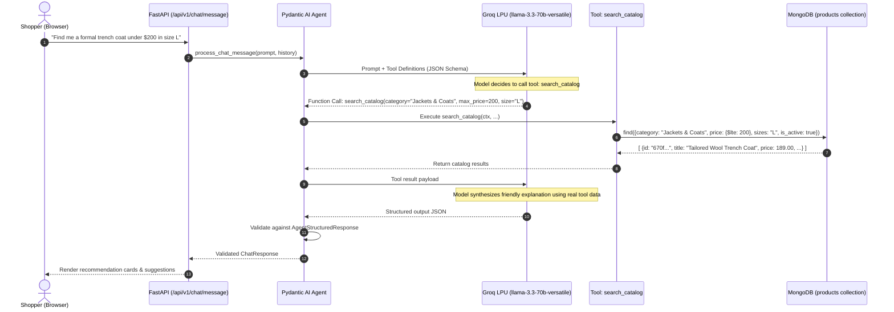

# Pydantic AI & Groq Agent Deep Dive

This document explains the architecture, tool invocation lifecycle, and validation guarantees of the **Aura GenAI Shopping Assistant**.

---

## 1. Why Pydantic AI over Generic Prompting?

Generic LLM chatbots often suffer from:
1. **Hallucination:** Fabricating non-existent clothing styles, wrong prices, or out-of-stock sizes.
2. **Context Window Bloat:** Attempting to stuff thousands of products into the initial system prompt.
3. **Unvalidated JSON:** Models generating broken syntax or missing required fields.

**Pydantic AI solves all three:**
- **Explicit Tool Definitions:** The LLM does not memorize the catalog. It is equipped with typed tools to search the database on demand.
- **Dependency Injection:** Database connections are cleanly passed via `RunContext[AgentDependencies]`, keeping tools decoupled and testable.
- **Strict Structured Outputs:** The final response is validated against the `AgentStructuredResponse` Pydantic model before sending to the client.

---

## 2. Agent Workflow & Tool Invocation



---

## 3. Registered Tools

The agent has three explicitly defined tools registered in `app/ai/agent.py`:

### 1. `search_catalog`
Searches the live MongoDB database for active, in-stock products matching customer parameters:
```python
@clothing_agent.tool
async def search_catalog(
    ctx: RunContext[AgentDependencies],
    query: Optional[str] = None,
    category: Optional[str] = None,
    max_price: Optional[float] = None,
    min_price: Optional[float] = None,
    size: Optional[str] = None,
    color: Optional[str] = None,
) -> List[Dict[str, Any]]:
    """Searches the clothing store's live database for active products in stock."""
    return await execute_search_products(
        db=ctx.deps.db,
        query=query,
        category=category,
        max_price=max_price,
        size=size,
        color=color,
        limit=6,
    )
```

### 2. `get_product_details`
Retrieves granular fabric specifications, care instructions, and variant stock for a single item when shoppers ask for comparisons or in-depth questions.

### 3. `get_available_categories`
Returns distinct active clothing categories so the agent can suggest relevant alternatives if a specific search returns zero results.

---

## 4. Structured Output Model

The agent is configured with `output_type=AgentStructuredResponse`:

```python
class AgentRecommendation(BaseModel):
    id: str = Field(description="Exact product ID from catalog")
    title: str = Field(description="Exact product title")
    price: float = Field(description="Exact product price in USD")
    category: str = Field(description="Category of the clothing item")
    image: str = Field(description="Product image path or URL")
    sizes: List[str] = Field(default_factory=list)
    colors: List[str] = Field(default_factory=list)
    match_reason: str = Field(description="Direct explanation of why this product fits the customer's request")

class AgentStructuredResponse(BaseModel):
    reply: str = Field(description="Conversational, helpful, and concise response to the customer")
    recommended_products: List[AgentRecommendation] = Field(default_factory=list)
    suggested_queries: List[str] = Field(default_factory=list)
```

If the LLM omits required fields, Pydantic AI triggers a retry or raises a validation exception which our fallback engine handles gracefully.

---

## 5. Offline Testing with `TestModel`

In automated CI/CD and unit tests, real API calls to Groq are prevented using `models.ALLOW_MODEL_REQUESTS = False`.

Using Pydantic AI's `TestModel`, we verify tool exposure without network calls or token costs:
```python
from pydantic_ai.models.test import TestModel

def test_agent_tools(mock_db):
    test_model = TestModel()
    with clothing_agent.override(model=test_model):
        res = clothing_agent.run_sync("Find coats", deps=AgentDependencies(db=mock_db))
    
    # Assert tools were presented to the model
    tools = [t.name for t in test_model.last_model_request_parameters.function_tools]
    assert "search_catalog" in tools
```
