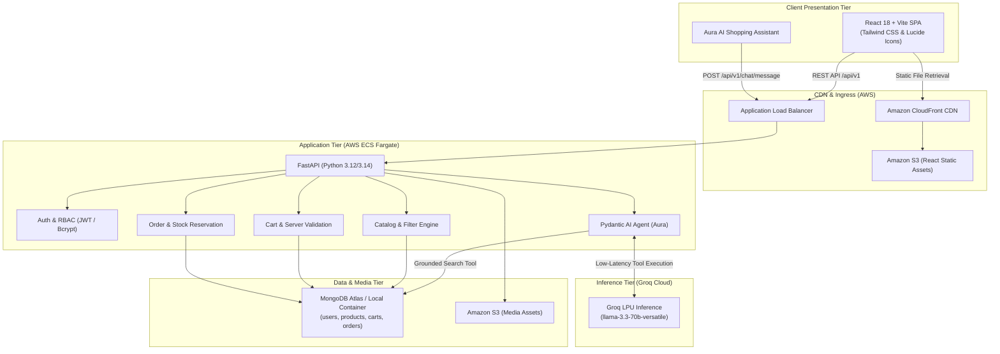

# Architecture & System Design Document

This document provides a comprehensive technical overview of the **GenAI-Powered Clothing Store**, explaining each architectural layer, data flow, security boundary, and cloud infrastructure decision.

---

## 1. System Overview

The system is designed as a decoupled, cloud-ready e-commerce platform featuring an integrated **GenAI shopping stylist** capable of grounded product retrieval and natural-language outfit recommendations.



---

## 2. Key Architectural Decisions & Rationales

### A. Backend: FastAPI + Pydantic v2
- **Why FastAPI?** Asynchronous ASGI architecture (`uvicorn`), native asynchronous MongoDB support via `Motor`, automatic OpenAPI specification generation, and strict typed validation through Pydantic v2.
- **Why Pydantic v2?** Core written in Rust (`pydantic-core`), providing 5-20x faster serialization/deserialization for large catalog queries compared to older frameworks.

### B. AI Layer: Pydantic AI with Groq
- **Why Pydantic AI?** Unlike unstructured langchain prompt chains, Pydantic AI treats tool calls, dependency injection (`RunContext`), and output validation as first-class Python constructs.
- **Why Groq?** Groq's custom Language Processing Units (LPUs) provide near-instantaneous token generation (250-400 tokens/sec for `llama-3.3-70b-versatile`). This makes multi-turn shopping chats feel conversational and human without frustrating pauses.
- **Zero-Hallucination Architecture:** The model is not given permission to invent products or prices. It has access to registered database search tools (`search_catalog`, `get_product_details`) and returns a strictly typed `AgentStructuredResponse`.

### C. Database: MongoDB (Motor Async Driver)
- **Why MongoDB?** Clothing catalog items have dynamic variants (multiple sizes, color arrays, varying fabric descriptions, tags, and image galleries). Document-oriented storage cleanly encapsulates variants in single documents without expensive multi-table SQL joins.
- **Atomic Operations:** Uses MongoDB's atomic document updates (`$inc: {"stock": -quantity}`) with conditional operators (`stock: {"$gte": quantity}`) to eliminate race conditions and prevent overselling during high-concurrency checkouts.

### D. Media Handling: Hybrid Storage Strategy
- **Local Development:** Uploads are validated against magic bytes and size limits, then saved to `backend/uploads/` and served via FastAPI static mount `/uploads/`.
- **AWS Production:** Uploads are streamed directly to Amazon S3, with access delivered globally via Amazon CloudFront.

---

## 3. Data Flow Scenarios

### Scenario 1: Natural Language Recommendation
1. Shopper prompts: *"Find me warm winter jackets under $150 in size L"*.
2. Frontend dispatches `POST /api/v1/chat/message` with recent conversation turns.
3. FastAPI invokes `process_chat_message`.
4. Pydantic AI agent analyzes parameters: `category="Jackets & Coats"`, `max_price=150`, `size="L"`, `tags=["warm", "winter"]`.
5. Agent calls tool `search_catalog(...)` with those constraints.
6. The tool executes an indexed MongoDB query on `db.products`.
7. Catalog results return to agent context.
8. Agent formats conversational guidance and outputs `AgentStructuredResponse`.
9. React renders product cards with instant "Add to Bag" buttons.

### Scenario 2: Secure Checkout with Inventory Decrement
1. Customer initiates checkout from `/checkout`.
2. Backend retrieves customer's cart and resolves real product prices from `db.products` (never trusting client prices).
3. Backend performs atomic stock decrement:
   ```python
   await db.products.update_one(
       {"_id": pid, "stock": {"$gte": qty}},
       {"$inc": {"stock": -qty}}
   )
   ```
4. If any item is out of stock, previous updates are rolled back and HTTP 400 is returned.
5. Snapshot of item titles, purchase prices, and variants is saved into an immutable order document.
6. Customer's cart is emptied.
